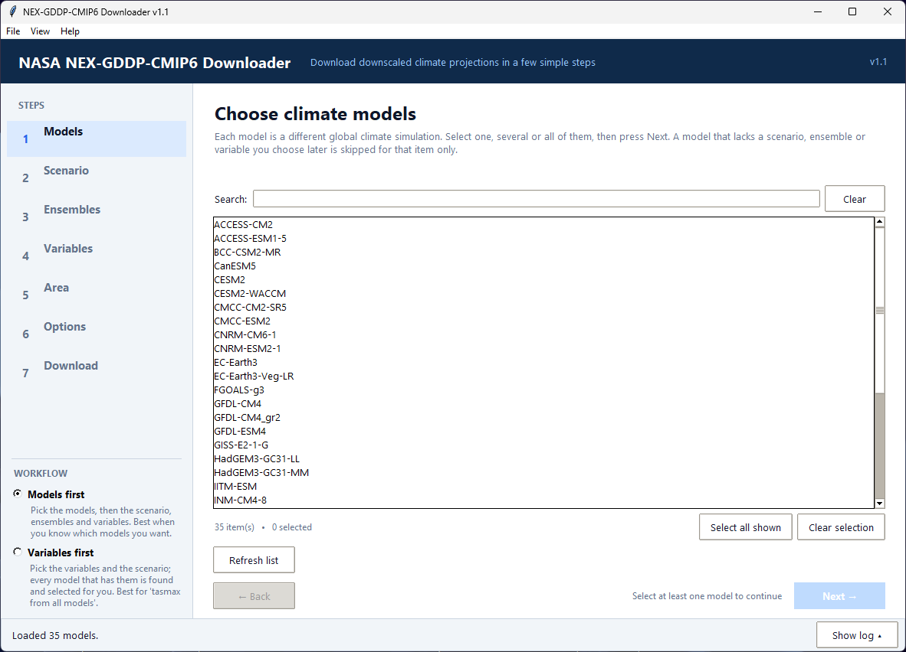
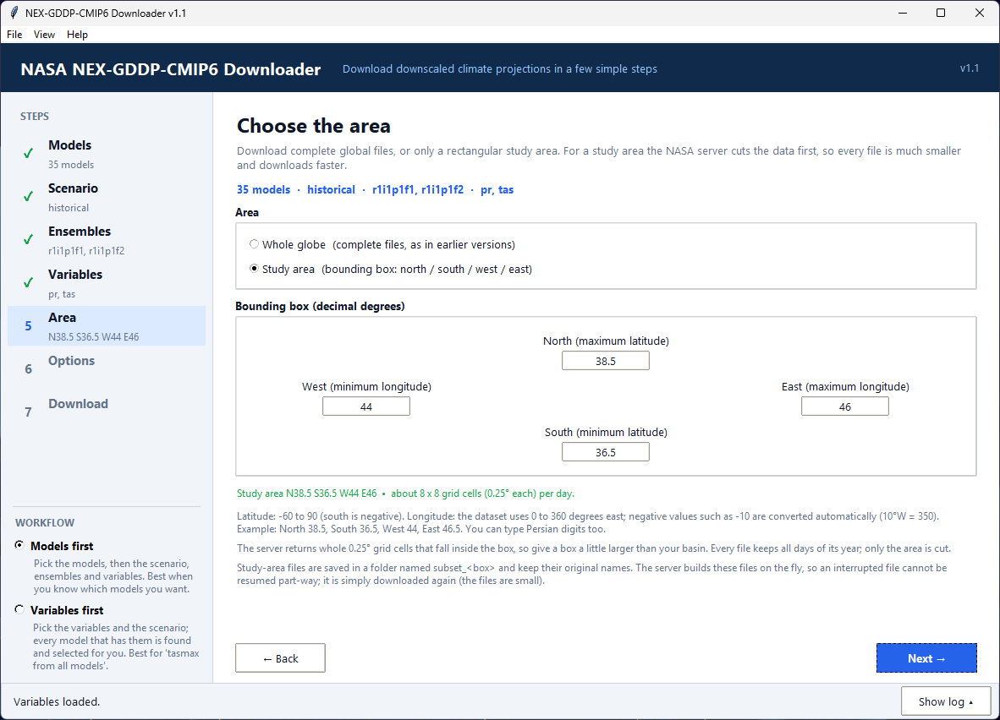
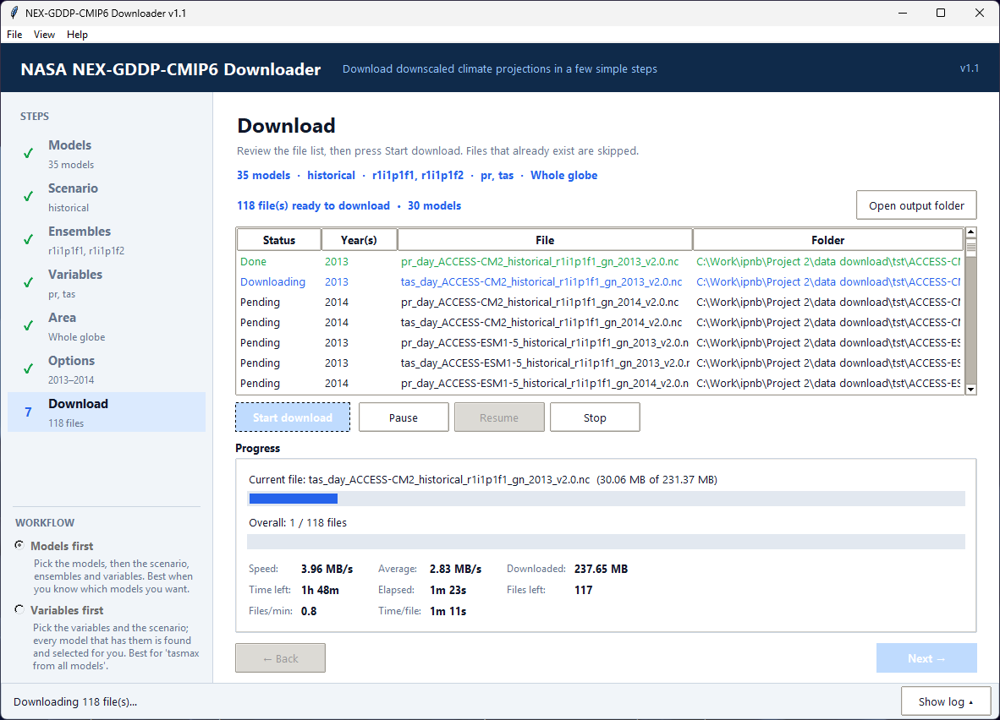

# NASA NEX-GDDP-CMIP6 Downloader

**A desktop and command-line tool for downloading NASA NEX-GDDP-CMIP6 climate data — globally or for a custom study area.**

[English](README.md) | [فارسی](README_FA.md)


---

## Overview

NASA NEX-GDDP-CMIP6 Downloader is a Python application designed to make downloading daily climate projection data from the NASA NEX-GDDP-CMIP6 dataset easier. It provides a guided graphical interface as well as a command-line mode, with options to download complete NetCDF files or request a rectangular study-area subset.

The application is intended for researchers and users working in climate science, hydrology, environmental studies, and related fields.

### Key capabilities

- Download complete dataset files or spatially subsetted files for a user-defined bounding box.
- Select climate models, scenarios, ensemble members, variables, and year ranges.
- Use either a **Models-first** or **Variables-first** selection workflow.
- Browse selections across models, including options available only in some selected models.
- Run downloads with progress reporting, retry handling, pause/resume/stop controls, and queue management.
- Use the command-line interface for headless downloads and run offline self-tests.

## Screenshots

### Main application


### Study-area selection


### Download queue and progress


---

## Dataset

The application accesses NASA's **NEX-GDDP-CMIP6** dataset via NASA's THREDDS services.

| Dataset property | Description |
|---|---|
| Spatial resolution | 0.25° (approximately 25 km) |
| Temporal resolution | Daily |
| Geographic coverage | Global dataset coverage (approximately 60°S to 90°N) |
| Historical period | 1950–2014 |
| Projection period | 2015–2100 |
| Data format | NetCDF |
| Dataset source | NASA NEX-GDDP-CMIP6 |

The available files and model-specific combinations are determined from the remote catalogs; availability may vary by model, scenario, ensemble, variable, and year.

### Scenarios

- `historical` — historical simulations (1950–2014)
- `ssp126` — SSP1-2.6
- `ssp245` — SSP2-4.5
- `ssp370` — SSP3-7.0
- `ssp585` — SSP5-8.5

### Climate variables

| Code | Description |
|---|---|
| `hurs` | Near-surface relative humidity (%) |
| `huss` | Near-surface specific humidity |
| `pr` | Precipitation |
| `rlds` | Surface downwelling longwave radiation |
| `rsds` | Surface downwelling shortwave radiation |
| `sfcWind` | Near-surface wind speed |
| `tas` | Daily mean near-surface air temperature |
| `tasmax` | Daily maximum near-surface air temperature |
| `tasmin` | Daily minimum near-surface air temperature |

---

## Features

### Guided graphical workflow

The GUI guides users through the selection and download process:

1. **Models** — choose one, several, or all available climate models.
2. **Scenario** — choose a historical simulation or an SSP pathway.
3. **Ensembles** — select ensemble members, or select all ensembles available for each model.
4. **Variables** — select the climate variables of interest.
5. **Area** — download global files or specify a study-area bounding box.
6. **Options** — set the output directory, year range, file-version filter, and download settings.
7. **Download** — review the queue and manage the download process.

The order can also be changed to a **Variables-first** workflow. In this mode, users choose variables and a scenario first; the application then finds and selects models that support those choices. The selected models can subsequently be adjusted.

### Multi-model and availability-aware selection

- Select individual models or select all models.
- Lists can include options available in at least one selected model, with availability counts.
- Optionally restrict lists to choices shared by every selected model.
- During queue construction, model-specific combinations that are unavailable are skipped rather than preventing other compatible selections from being downloaded.
- Select all ensembles available for each selected model, or manually choose ensembles.

### Study-area downloads

The **Area** step lets you choose between downloading full global files and downloading a rectangular study area.

- Specify the bounding box using **North, South, West, and East** coordinates.
- Longitudes may be entered using the `-180…180` or `0…360` convention; negative longitudes are converted for the dataset service.
- Persian and Arabic numerals are accepted in coordinate inputs.
- The application estimates the number of grid cells covered by the box.
- Subset requests use NASA THREDDS **NetcdfSubset (NCSS)**, which generates the requested subset on the server.
- Subset files are stored in a separate `subset_<box>` directory to distinguish areas.

**Important:** NCSS subset files are generated by the server and use a single connection per file. They do not support the segmented/resumable transfer behavior used for whole-file downloads. If a subset download fails or is stopped, the incomplete file is removed and the file must be requested again.

### Download management

- Queue review before downloading.
- Configurable parallel connections for whole-file downloads.
- Segmented downloading of whole files.
- Resume support for interrupted whole-file downloads.
- Pause, resume, and stop controls.
- Automatic retries with backoff for recoverable network errors.
- Progress, transfer speed, and estimated time remaining.
- Disk-space checks and handling for disk-full errors.
- Checks of downloaded file size and NetCDF signature; these checks are not a substitute for full scientific or structural validation.

### Catalog caching

Remote catalogs are retrieved in parallel and cached to speed up repeated searches. The disk catalog cache is retained for up to seven days. Refresh controls and the cache-clearing option are available from the application.

### Command-line mode and self-test

The application can run without its graphical interface using `--cli`. It also includes an offline self-test mode (`--self-test`) for internal checks.

---

## Getting started

### Option 1 — Download a release

If a packaged executable is provided in the project's **Releases** section:

1. Open [Releases](https://github.com/haadiasghari/NEX-GDDP-CMIP6-Downloader/releases).
2. Download the release asset for your operating system, if available.
3. Run the application.

> Release assets and packaging availability depend on what is published for each release. If no executable is provided, use the Python source instructions below.

### Option 2 — Run from source

#### Requirements

- Windows 10 or newer, macOS 10.14 or newer, or Linux (as stated in the application's source documentation; GUI availability depends on Tk support on your system).
- Python 3.7 or newer.
- `requests`.
- `tkinter` for the graphical interface (usually included with standard Python installations; not required for CLI or self-test mode).

#### Download the source

```bash
git clone https://github.com/haadiasghari/NEX-GDDP-CMIP6-Downloader.git
cd NEX-GDDP-CMIP6-Downloader
```

Install the Python dependency:

```bash
python -m pip install requests
```

Run the program (use the actual Python script filename in the repository):

```bash
python nex_gddp_cmip6_downloader.py
```

If the script filename differs, substitute the repository's filename.

---

## Usage

### GUI

Use the stages in the sidebar to make your selections, review the download queue, and start downloading. The built-in Quick Guide is available with **F1**.

### Command line

CLI mode requires the selection arguments shown below. Run the program with `--help` to display its command-line options.

Example: download precipitation and maximum temperature for one model, one scenario, and a year range, for a rectangular area:

```bash
python nex_gddp_cmip6_downloader.py --cli \
  --models ACCESS-CM2 \
  --scenario ssp245 \
  --variables pr tasmax \
  --years 2015 2030 \
  --out ./cmip6_downloads \
  --bbox 38.5 36.5 44 46.5
```

Bounding box order is:

```text
NORTH SOUTH WEST EAST
```

For a global download, omit `--bbox`. The CLI supports these options:

| Argument | Description |
|---|---|
| `--cli` | Run without the GUI |
| `--self-test` | Run offline internal tests and exit |
| `--models` | One or more model names, or `all` |
| `--scenario` | Scenario, such as `historical` or `ssp245` |
| `--ensembles` | One or more ensemble identifiers, or `all` |
| `--variables` | One or more variable codes |
| `--years` | Inclusive start and end year |
| `--bbox` | Bounding box: North, South, West, East; optional |
| `--out` | Output directory (default: `cmip6_downloads`) |
| `--version-filter` | `latest`, `all`, or a version string (default: `latest`) |
| `--workers` | Parallel connections for whole-file downloads (default: 4; range: 1–16) |
| `--segments` | Segments per whole file (default: 8; range: 1–32) |

Example self-test:

```bash
python nex_gddp_cmip6_downloader.py --self-test
```

---

## Output organization

Global files are organized by model, scenario, ensemble, and variable. Study-area files use a separate area-specific directory.

### Global download example

```text
cmip6_downloads/
└── ACCESS-CM2/
    └── ssp245/
        └── r1i1p1f1/
            └── tasmax/
                ├── tasmax_day_ACCESS-CM2_ssp245_r1i1p1f1_gn_2015_v2.0.nc
                └── ...
```

### Study-area example

```text
cmip6_downloads/
└── subset_N38p5_S36p5_W44_E46p5/
    └── ACCESS-CM2/
        └── ssp245/
            └── r1i1p1f1/
                └── tasmax/
                    └── ...
```

File names are retained from the source dataset.

---

## Settings

The application provides configurable options including:

| Setting | Description |
|---|---|
| Output directory | Destination folder for downloaded data |
| Year range | Inclusive year range to queue |
| File-version filter | Choose latest version, all versions, or a specific version string |
| Workers | Number of parallel whole-file connections (1–16) |
| Segments | Number of segments per whole file (1–32) |

The default values for workers and segments are **4** and **8**, respectively.

---

## Logs, configuration, and cache

The application stores local configuration, logs, crash diagnostics, and catalog cache in your home directory:

| File / folder | Purpose |
|---|---|
| `~/.nex_gddp_cmip6_downloader.json` | Saved application settings |
| `~/.nex_gddp_cmip6_downloader.log` | Rotating activity log |
| `~/.nex_gddp_cmip6_downloader.crash.log` | Crash and traceback diagnostics |
| `~/.nex_gddp_cmip6_downloader.cache/` | Catalog cache (up to 7 days) |

Use the application's cache-clearing functionality if you need to force catalog data to be retrieved again.

---

## Keyboard shortcuts

| Shortcut | Action |
|---|---|
| `F1` | Open Quick Guide |
| `F5` | Refresh the current stage/list |
| `Alt + Right` | Next step |
| `Alt + Left` | Previous step |
| `Ctrl + L` | Show/hide activity log |
| `Ctrl + Q` | Quit |

---

## Data source and citation

**Dataset:** NASA NEX-GDDP-CMIP6

- [NASA NEX-GDDP-CMIP6 information](https://www.nccs.nasa.gov/services/data-collections/land-based-products/nex-gddp-cmip6)
- [NASA NEX](https://www.nasa.gov/nex)

This application is a third-party downloader and is not affiliated with, endorsed by, or maintained by NASA.

Users are responsible for citing the dataset and relevant data documentation in their research and publications, according to NASA's recommended citation guidance.

---

## Support the project

If the project helps your research or work, you may support its continued development.

**Reymit (IRR):** [Donation page](https://reymit.ir/hadi_asghari)

**Bitcoin:**
```text
bc1q79zvr4a0k6qfzxv8hyc82mjqqfs5cvcspalqxp
```

Thank you for supporting open-source software ❤️

---

## Author

**Hadi Asghari**

- GitHub: [haadiasghari](https://github.com/haadiasghari)
- Repository: [NEX-GDDP-CMIP6-Downloader](https://github.com/haadiasghari/NEX-GDDP-CMIP6-Downloader)
- Email: [hadi.asghari@outlook.com](mailto:hadi.asghari@outlook.com)
- LinkedIn: [haadi-asghari](https://www.linkedin.com/in/haadi-asghari/)

## License

This project is licensed under the **MIT License**. See the [`LICENSE`](LICENSE) file for details.

## Contributing

Bug reports, feature requests, suggestions, and pull requests are welcome. Please open an issue to discuss significant changes before submitting a pull request.
