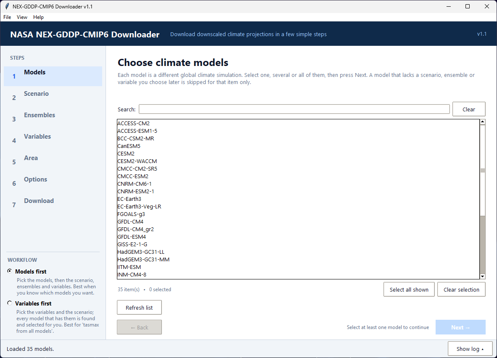
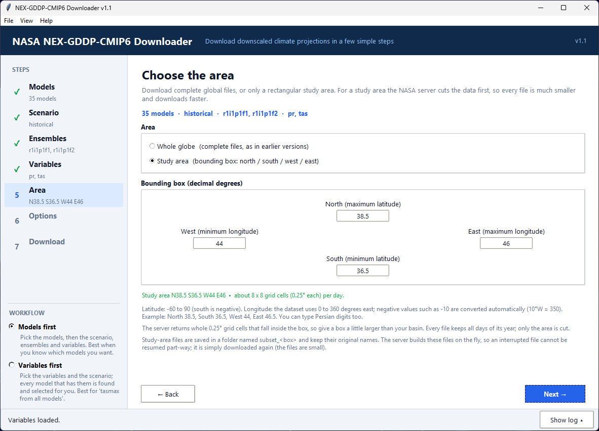
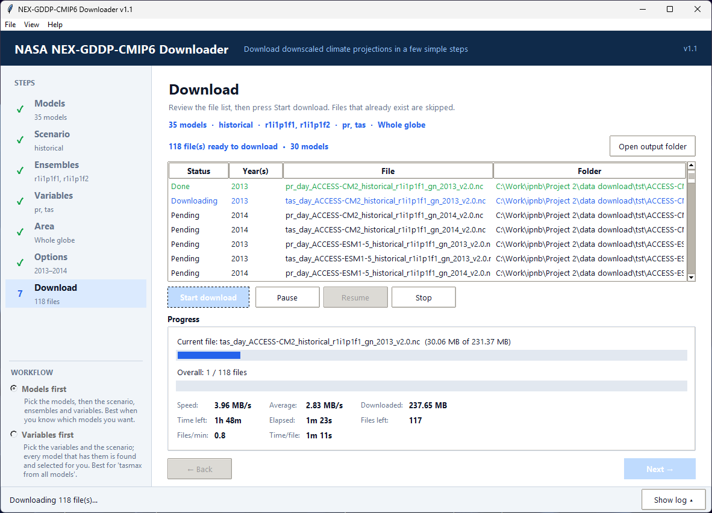

# دانلودکننده NASA NEX-GDDP-CMIP6

**ابزاری برای دانلود داده‌های اقلیمی روزانه NASA NEX-GDDP-CMIP6، به‌صورت جهانی یا برای محدوده مکانی دلخواه.**

[English](README.md) | [فارسی](README_FA.md)


---

## معرفی

NASA NEX-GDDP-CMIP6 Downloader یک برنامه پایتونی برای ساده‌سازی دریافت داده‌های اقلیمی روزانه از مجموعه داده NASA NEX-GDDP-CMIP6 است. این برنامه علاوه بر رابط گرافیکی مرحله‌به‌مرحله، از اجرای خط فرمان نیز پشتیبانی می‌کند و امکان دریافت فایل‌های کامل NetCDF یا فایل‌های برش‌خورده مکانی برای یک محدوده مستطیلی را فراهم می‌سازد.

این ابزار برای پژوهشگران حوزه علوم اقلیم، هیدرولوژی، مطالعات محیط‌زیستی و زمینه‌های مرتبط طراحی شده است.

### قابلیت‌های اصلی

- دانلود فایل‌های کامل مجموعه داده یا فایل‌های محدودشده به محدوده مکانی دلخواه.
- انتخاب مدل‌های اقلیمی، سناریوها، اعضای ensemble، متغیرها و بازه زمانی.
- پشتیبانی از دو روند انتخاب **Models-first** و **Variables-first**.
- نمایش گزینه‌های قابل دسترس در مدل‌های انتخاب‌شده، حتی اگر همه مدل‌ها آن گزینه را نداشته باشند.
- مدیریت دانلود با نمایش پیشرفت، تلاش مجدد، توقف موقت/ادامه/توقف، و مدیریت صف.
- اجرای بدون رابط گرافیکی از طریق CLI و اجرای آزمون‌های داخلی آفلاین.

## تصاویر برنامه

> تصاویر برنامه پس از تهیه در پوشه `screenshots/` مخزن قرار داده می‌شوند. در صورت تغییر نام فایل‌ها، مسیرهای تصاویر در این بخش نیز اصلاح شوند.

### صفحه اصلی برنامه


### انتخاب محدوده مکانی


### صف دانلود و وضعیت پیشرفت


---

## مشخصات مجموعه داده

این برنامه به مجموعه داده **NASA NEX-GDDP-CMIP6** از طریق سرویس‌های THREDDS ناسا دسترسی پیدا می‌کند.

| ویژگی | توضیحات |
|---|---|
| تفکیک مکانی | ۰٫۲۵ درجه (حدود ۲۵ کیلومتر) |
| تفکیک زمانی | روزانه |
| پوشش مکانی | جهانی (تقریباً از ۶۰ درجه جنوبی تا ۹۰ درجه شمالی) |
| دوره تاریخی | ۱۹۵۰ تا ۲۰۱۴ |
| دوره پیش‌بینی/پروژکشن | ۲۰۱۵ تا ۲۱۰۰ |
| قالب داده | NetCDF |
| منبع داده | NASA NEX-GDDP-CMIP6 |

فهرست فایل‌ها و ترکیب‌های قابل دریافت، از کاتالوگ‌های آنلاین استخراج می‌شوند؛ بنابراین دسترسی به گزینه‌ها ممکن است بر اساس مدل، سناریو، ensemble، متغیر و سال متفاوت باشد.

### سناریوها

- `historical` — شبیه‌سازی تاریخی (۱۹۵۰ تا ۲۰۱۴)
- `ssp126` — سناریوی SSP1-2.6
- `ssp245` — سناریوی SSP2-4.5
- `ssp370` — سناریوی SSP3-7.0
- `ssp585` — سناریوی SSP5-8.5

### متغیرهای اقلیمی

| کد | توضیحات |
|---|---|
| `hurs` | رطوبت نسبی نزدیک سطح زمین (%) |
| `huss` | رطوبت ویژه نزدیک سطح زمین |
| `pr` | بارش |
| `rlds` | تابش موج بلند ورودی سطحی |
| `rsds` | تابش موج کوتاه ورودی سطحی |
| `sfcWind` | سرعت باد نزدیک سطح زمین |
| `tas` | میانگین دمای روزانه هوای نزدیک سطح زمین |
| `tasmax` | حداکثر دمای روزانه هوای نزدیک سطح زمین |
| `tasmin` | حداقل دمای روزانه هوای نزدیک سطح زمین |

---

## امکانات

### روند راهنمای مرحله‌به‌مرحله

رابط گرافیکی برنامه مراحل انتخاب و دریافت داده را هدایت می‌کند:

1. **Models (مدل‌ها)** — انتخاب یک، چند یا همه مدل‌های اقلیمی موجود.
2. **Scenario (سناریو)** — انتخاب شبیه‌سازی تاریخی یا مسیر SSP.
3. **Ensembles (اعضای ensemble)** — انتخاب اعضا یا دریافت تمام ensembleهای موجود برای هر مدل.
4. **Variables (متغیرها)** — انتخاب متغیرهای اقلیمی موردنظر.
5. **Area (محدوده)** — دریافت فایل‌های جهانی یا تعیین محدوده مطالعه.
6. **Options (تنظیمات)** — تعیین پوشه خروجی، بازه سال، فیلتر نسخه و تنظیمات دانلود.
7. **Download (دانلود)** — مرور صف و مدیریت فرایند دریافت.

همچنین می‌توان روند انتخاب را به حالت **Variables-first** تغییر داد. در این حالت ابتدا متغیرها و سناریو انتخاب می‌شوند و سپس برنامه مدل‌هایی را که با انتخاب‌ها سازگار هستند شناسایی و انتخاب می‌کند. کاربر می‌تواند مدل‌های انتخاب‌شده را بعداً تغییر دهد.

### انتخاب چندمدلی و آگاه از دسترس‌پذیری

- انتخاب یک مدل، چند مدل یا تمام مدل‌ها.
- نمایش گزینه‌هایی که دست‌کم در یکی از مدل‌های انتخاب‌شده موجود هستند، همراه با شمارنده دسترس‌پذیری.
- امکان محدودکردن فهرست به گزینه‌های مشترک بین تمام مدل‌های انتخاب‌شده.
- در ساخت صف، ترکیب‌های ناسازگار یا غیرموجود برای هر مدل کنار گذاشته می‌شوند؛ وجود یک متغیر یا ensemble در یک مدل، دریافت گزینه‌های سازگار سایر مدل‌ها را محدود نمی‌کند.
- انتخاب همه ensembleهای موجود برای هر مدل یا انتخاب دستی اعضا.

### دانلود محدوده مکانی (Study Area)

در مرحله **Area** می‌توان بین دریافت فایل‌های کامل جهانی و دریافت محدوده مستطیلی دلخواه انتخاب کرد.

- تعیین محدوده با مختصات **North، South، West و East**.
- پذیرش طول جغرافیایی در قالب `-180…180` یا `0…360`؛ طول‌های منفی برای سرویس داده تبدیل می‌شوند.
- پذیرش ارقام فارسی و عربی در فیلدهای مختصات.
- نمایش تخمینی تعداد سلول‌های شبکه‌ای پوشش‌داده‌شده توسط محدوده.
- استفاده از سرویس **NetcdfSubset (NCSS)** ناسا/THREDDS برای تولید برش مکانی در سمت سرور.
- ذخیره فایل‌های محدوده مکانی در پوشه مجزای `subset_<box>` برای جلوگیری از اختلاط محدوده‌ها.

**نکته مهم:** فایل‌های NCSS در سمت سرور تولید می‌شوند و مانند دانلود فایل کامل از قابلیت دانلود segmented و Resume برخوردار نیستند. هر فایل محدوده مکانی با یک اتصال دریافت می‌شود؛ در صورت شکست یا توقف، فایل ناقص حذف شده و درخواست دریافت آن باید دوباره انجام شود.

### مدیریت دانلود

- مرور صف پیش از شروع دانلود.
- تنظیم تعداد اتصال‌های موازی برای دانلود فایل‌های کامل.
- دانلود segmented فایل‌های کامل.
- ادامه دانلود فایل‌های کامل پس از قطع یا توقف.
- Pause، Resume و Stop.
- تلاش مجدد خودکار با backoff برای خطاهای شبکه قابل بازیابی.
- نمایش پیشرفت، سرعت و زمان تخمینی باقی‌مانده.
- بررسی فضای آزاد دیسک و مدیریت خطاهای کمبود فضا.
- بررسی اندازه فایل و امضای NetCDF؛ این بررسی‌ها جایگزین اعتبارسنجی کامل ساختاری یا علمی فایل نیستند.

### کش کاتالوگ

دریافت کاتالوگ‌های آنلاین به‌صورت موازی انجام می‌شود و برای سرعت بیشتر، داده‌های کاتالوگ در حافظه و دیسک ذخیره می‌شوند. مدت نگهداری کش دیسکی حداکثر هفت روز است. امکان Refresh و پاک‌کردن کش نیز در برنامه فراهم شده است.

### اجرای خط فرمان و Self-test

برنامه قابلیت اجرا بدون رابط گرافیکی از طریق `--cli` را دارد. همچنین گزینه `--self-test` آزمون‌های داخلی آفلاین را اجرا می‌کند.

---

## شروع به کار

### روش اول — دریافت نسخه منتشرشده

در صورت انتشار فایل اجرایی در بخش **Releases** مخزن:

1. به صفحه [Releases](https://github.com/haadiasghari/NEX-GDDP-CMIP6-Downloader/releases) مراجعه کنید.
2. فایل منتشرشده برای سیستم‌عامل خود را، در صورت وجود، دانلود کنید.
3. برنامه را اجرا کنید.

> وجود فایل اجرایی و بسته‌بندی برای سیستم‌عامل‌های مختلف به محتویات هر Release بستگی دارد. اگر فایل اجرایی منتشر نشده باشد، از روش اجرای سورس استفاده کنید.

### روش دوم — اجرا از سورس پایتون

#### پیش‌نیازها

- Windows 10 یا جدیدتر، macOS 10.14 یا جدیدتر، یا Linux (طبق توضیحات سورس؛ دسترسی به GUI به پشتیبانی Tk در سیستم وابسته است).
- Python نسخه ۳٫۷ یا بالاتر.
- کتابخانه `requests`.
- `tkinter` برای رابط گرافیکی (معمولاً همراه نصب استاندارد Python است؛ برای CLI و self-test لازم نیست).

#### دریافت سورس

```bash
git clone https://github.com/haadiasghari/NEX-GDDP-CMIP6-Downloader.git
cd NEX-GDDP-CMIP6-Downloader
```

نصب وابستگی:

```bash
python -m pip install requests
```

اجرای برنامه (نام فایل اسکریپت را مطابق فایل موجود در مخزن وارد کنید):

```bash
python nex_gddp_cmip6_downloader.py
```

اگر نام فایل اسکریپت متفاوت است، نام واقعی آن را جایگزین کنید.

---

## نحوه استفاده

### رابط گرافیکی

از مراحل موجود در نوار کناری برای انتخاب داده‌ها استفاده کنید، صف دانلود را بررسی کرده و دانلود را آغاز کنید. راهنمای داخلی برنامه با کلید **F1** در دسترس است.

### خط فرمان (CLI)

برای نمایش گزینه‌های کامل CLI از `--help` استفاده کنید. نمونه زیر بارش و حداکثر دمای روزانه را برای یک مدل، سناریو و بازه سال، در محدوده مکانی مشخص دریافت می‌کند:

```bash
python nex_gddp_cmip6_downloader.py --cli \
  --models ACCESS-CM2 \
  --scenario ssp245 \
  --variables pr tasmax \
  --years 2015 2030 \
  --out ./cmip6_downloads \
  --bbox 38.5 36.5 44 46.5
```

ترتیب مختصات محدوده:

```text
NORTH SOUTH WEST EAST
```

برای دانلود جهانی، گزینه `--bbox` را حذف کنید.

| آرگومان | توضیح |
|---|---|
| `--cli` | اجرا بدون رابط گرافیکی |
| `--self-test` | اجرای آزمون‌های داخلی آفلاین و خروج |
| `--models` | نام یک یا چند مدل یا `all` |
| `--scenario` | سناریو مانند `historical` یا `ssp245` |
| `--ensembles` | یک یا چند شناسه ensemble یا `all` |
| `--variables` | یک یا چند کد متغیر |
| `--years` | سال شروع و پایان (شامل هر دو سال) |
| `--bbox` | محدوده North، South، West، East (اختیاری) |
| `--out` | پوشه خروجی (پیش‌فرض: `cmip6_downloads`) |
| `--version-filter` | `latest`، `all` یا رشته نسخه (پیش‌فرض: `latest`) |
| `--workers` | تعداد اتصال موازی فایل‌های کامل (پیش‌فرض: ۴؛ بازه ۱ تا ۱۶) |
| `--segments` | تعداد قطعه برای هر فایل کامل (پیش‌فرض: ۸؛ بازه ۱ تا ۳۲) |

اجرای آزمون داخلی:

```bash
python nex_gddp_cmip6_downloader.py --self-test
```

---

## ساختار خروجی

فایل‌های جهانی بر اساس مدل، سناریو، ensemble و متغیر سازمان‌دهی می‌شوند. فایل‌های محدوده مکانی در زیرپوشه‌ای اختصاصی ذخیره می‌شوند.

### نمونه ساختار دانلود جهانی

```text
cmip6_downloads/
└── ACCESS-CM2/
    └── ssp245/
        └── r1i1p1f1/
            └── tasmax/
                ├── tasmax_day_ACCESS-CM2_ssp245_r1i1p1f1_gn_2015_v2.0.nc
                └── ...
```

### نمونه ساختار دانلود محدوده مکانی

```text
cmip6_downloads/
└── subset_N38p5_S36p5_W44_E46p5/
    └── ACCESS-CM2/
        └── ssp245/
            └── r1i1p1f1/
                └── tasmax/
                    └── ...
```

نام فایل‌ها مطابق نام فایل‌های منبع حفظ می‌شود.

---

## تنظیمات

| تنظیم | توضیح |
|---|---|
| پوشه خروجی | مسیر ذخیره داده‌های دانلودشده |
| بازه سال | بازه سال‌های انتخاب‌شده برای صف |
| فیلتر نسخه | آخرین نسخه، تمام نسخه‌ها یا رشته نسخه مشخص |
| Workers | تعداد اتصال موازی برای فایل‌های کامل (۱ تا ۱۶) |
| Segments | تعداد قطعات هر فایل کامل (۱ تا ۳۲) |

مقادیر پیش‌فرض Workers و Segments به‌ترتیب **۴** و **۸** هستند.

---

## فایل‌های تنظیمات، گزارش و کش

برنامه فایل تنظیمات، گزارش فعالیت، گزارش خطا و کش کاتالوگ را در پوشه Home کاربر ذخیره می‌کند:

| مسیر | کاربرد |
|---|---|
| `~/.nex_gddp_cmip6_downloader.json` | تنظیمات ذخیره‌شده برنامه |
| `~/.nex_gddp_cmip6_downloader.log` | گزارش چرخشی فعالیت |
| `~/.nex_gddp_cmip6_downloader.crash.log` | گزارش خطا و traceback |
| `~/.nex_gddp_cmip6_downloader.cache/` | کش کاتالوگ (تا ۷ روز) |

برای دریافت دوباره اطلاعات کاتالوگ، از قابلیت Refresh یا پاک‌کردن کش در برنامه استفاده کنید.

---

## میانبرهای صفحه‌کلید

| میانبر | عملکرد |
|---|---|
| `F1` | نمایش راهنمای سریع |
| `F5` | Refresh مرحله/فهرست جاری |
| `Alt + Right` | مرحله بعد |
| `Alt + Left` | مرحله قبل |
| `Ctrl + L` | نمایش/پنهان‌کردن Activity Log |
| `Ctrl + Q` | خروج |

---

## منبع داده و ارجاع علمی

**مجموعه داده:** NASA NEX-GDDP-CMIP6

- [اطلاعات NASA NEX-GDDP-CMIP6](https://www.nccs.nasa.gov/services/data-collections/land-based-products/nex-gddp-cmip6)
- [NASA NEX](https://www.nasa.gov/nex)

این برنامه یک ابزار دانلود مستقل است و وابسته به ناسا نیست؛ همچنین از سوی ناسا تأیید یا پشتیبانی رسمی نشده است.

کاربران مسئول رعایت دستورالعمل‌های ارجاع و استناد ناسا به مجموعه داده و مستندات مربوطه در مقالات و آثار پژوهشی خود هستند.

---

## حمایت از پروژه

اگر این پروژه در پژوهش یا فعالیت شما مفید بوده است، می‌توانید از ادامه توسعه آن حمایت کنید.

**Reymit (IRR):** [صفحه پرداخت](https://reymit.ir/)

**Bitcoin:**
```text
bc1q79zvr4a0k6qfzxv8hyc82mjqqfs5cvcspalqxp
```

از حمایت شما از نرم‌افزار متن‌باز سپاسگزارم ❤️

---

## نویسنده

**Hadi Asghari**

- GitHub: [haadiasghari](https://github.com/haadiasghari)
- مخزن پروژه: [NEX-GDDP-CMIP6-Downloader](https://github.com/haadiasghari/NEX-GDDP-CMIP6-Downloader)
- ایمیل: [hadi.asghari@outlook.com](mailto:hadi.asghari@outlook.com)
- LinkedIn: [haadi-asghari](https://www.linkedin.com/in/haadi-asghari/)

## مجوز

این پروژه تحت مجوز **MIT** منتشر شده است. برای جزئیات به فایل [`LICENSE`](LICENSE) مراجعه کنید.

## مشارکت

گزارش خطا، پیشنهاد قابلیت، ایده و Pull Request پذیرفته می‌شود. برای تغییرات اساسی، بهتر است پیش از ارسال Pull Request یک Issue ثبت کنید.
